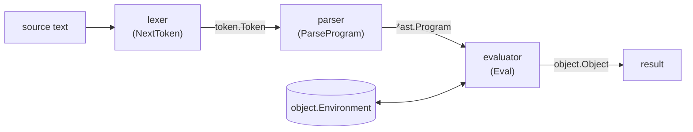

# Monkey interpreter in Go

[](https://github.com/SJrX/Interpreter_Go/actions/workflows/ci.yml)

A tree-walking interpreter for **Monkey**, the small programming language
designed in Thorsten Ball's book
[*Writing An Interpreter In Go*](https://interpreterbook.com/).

The source code is lexed into tokens, parsed into an abstract syntax tree (AST)
with a Pratt parser, and evaluated by walking that tree directly. There is no
bytecode or virtual machine.

## Attribution

This repository is a fork of
[SaladinoBelisario/Interpreter_Go](https://github.com/SaladinoBelisario/Interpreter_Go)
by Saladino Belisario, who wrote the interpreter while working through the book.
That code is MIT-licensed. See [LICENSE](LICENSE).

The Monkey language, and the design of this interpreter, come from
[*Writing An Interpreter In Go*](https://interpreterbook.com/) by
Thorsten Ball. If you find this project useful, the book explains every part of
it step by step and is well worth reading. This project is not affiliated with
the book or its author.

Changes made in this fork are listed in the Git history.

## The language

Monkey has integers, booleans, strings, arrays, hashes, first-class functions
and closures, with a C-like syntax.

```
let total = (2 + 3) * 4;                      // 20
let greeting = "Hello, " + "Monkey";          // "Hello, Monkey"

let colours = ["red", "green", "blue"];
colours[1];                                   // "green"

let book = {"title": "Monkey", "pages": 42};
book["pages"];                                // 42
```

Functions are values. The last expression in a function body is its result,
and `return` is also available:

```
let square = fn(n) { n * n };
square(7);                                    // 49

let factorial = fn(n) {
  if (n < 2) { 1 } else { n * factorial(n - 1) }
};
factorial(5);                                 // 120
```

Functions can take and return other functions, and closures capture their
environment:

```
let applyTwice = fn(f, x) { f(f(x)) };
applyTwice(fn(x) { x * 3 }, 2);               // 18

let makeAdder = fn(n) { fn(x) { x + n } };
let addTen = makeAdder(10);
addTen(5);                                    // 15
```

### Built-in functions

| Function | Description | Example |
|---|---|---|
| `len(x)` | Length of a string or array | `len("monkey")` → `6` |
| `first(arr)` | First element of an array | `first([1, 2, 3])` → `1` |
| `last(arr)` | Last element of an array | `last([1, 2, 3])` → `3` |
| `rest(arr)` | A new array without the first element | `rest([1, 2, 3])` → `[2, 3]` |
| `push(arr, x)` | A new array with `x` appended | `push([1, 2], 3)` → `[1, 2, 3]` |
| `puts(x...)` | Print values, returns `null` | `puts("hi")` |

### Operators

- Arithmetic on integers: `+`, `-`, `*`, `/`
- Comparison: `<`, `>`, `==`, `!=`
- Prefix: `-` (negation), `!` (logical not)
- String concatenation: `+`
- Indexing: `array[i]`, `hash[key]`

### Known limitations

These come from the book's design. They are not bugs:

- Integers only. There are no floating-point numbers.
- No `<=` or `>=`.
- Identifiers may contain only letters and `_` (no digits).
- No loops. Use recursion instead.
- No comments in Monkey source.

## Getting started

Requires Go 1.22 or newer.

Run the REPL:

```
go run .
```

```
>> let makeAdder = fn(n) { fn(x) { x + n } };
>> let addTen = makeAdder(10);
>> addTen(5)
15
```

Run the tests and checks that CI runs:

```
gofmt -l .
go vet ./...
go test -race ./...
go run honnef.co/go/tools/cmd/staticcheck@2026.2.1 ./...
```

## Project layout

| Package | Responsibility |
|---|---|
| `token` | Token types produced by the lexer |
| `lexer` | Turns source text into tokens |
| `ast` | The abstract syntax tree node types |
| `parser` | Pratt parser that builds the AST from tokens |
| `object` | Runtime values (integers, strings, functions, …) and environments |
| `evaluator` | Walks the AST and evaluates it, plus the built-in functions |
| `repl` | The interactive read-eval-print loop |

## How the pieces fit together

Running a program is a pipeline: text becomes tokens, tokens become a tree, and
the tree is evaluated into a value.



- The **parser drives the lexer**. `parser.New(lexer.New(src))` asks the lexer
  for one token at a time, keeping the current and next token
  (`curToken`/`peekToken`). The whole source is never turned into a token list
  up front.
- The **evaluator** is one big recursive `Eval(node, env)` with a `switch` on
  the AST node type. It returns `object.Object` values, which are also used for
  errors (`*object.Error`) and `return` (`*object.ReturnValue`).
- **Variables live in an `object.Environment`**, a map plus a pointer to an
  enclosing environment. Calling a function creates a new environment whose
  parent is the one where the function was *defined*, which is what makes
  closures work.
- The **REPL** (`repl.Start`) runs this pipeline once per line, reusing the same
  environment, so bindings from earlier lines stay visible.

### Worked example

Here is what happens to this program at each stage:

```
let double = fn(x) { x * 2 }; double(1 + 2)
```

**1. Lexing.** The lexer turns the text into tokens: a type, plus the literal
text it came from:

```
LET "let"   IDENT "double"   = "="   FUNCTION "fn"   ( "("   IDENT "x"   ) ")"
{ "{"   IDENT "x"   * "*"   INT "2"   } "}"   ; ";"
IDENT "double"   ( "("   INT "1"   + "+"   INT "2"   ) ")"
```

Keywords such as `let` and `fn` are identified by looking the word up in a
keyword table (`token.LookupIdent`). Anything else is an `IDENT`.

**2. Parsing.** The Pratt parser builds a tree. Each token type has a
*prefix* function (for a token that starts an expression, such as `fn` or a
number) and/or an *infix* function (for a token between two expressions,
such as `+`, or `(` for a call). A precedence table decides how tightly
operators bind, which is why `1 + 2` becomes a single argument.

```
Program
├── LetStatement  name=double
│   └── FunctionLiteral  params=[x]
│       └── BlockStatement
│           └── InfixExpression  *
│               ├── Identifier  x
│               └── IntegerLiteral  2
└── ExpressionStatement
    └── CallExpression
        ├── function: Identifier  double
        └── arguments:
            └── InfixExpression  +
                ├── IntegerLiteral  1
                └── IntegerLiteral  2
```

Printing the AST back with `String()` shows the grouping the parser chose:

```
let double = fn(x) (x * 2);
double((1 + 2))
```

**3. Evaluation.** `Eval` walks the tree:

1. The `LetStatement` evaluates the `FunctionLiteral` into an
   `*object.Function`. That holds the parameters, the body and a pointer to
   the current (global) environment. It's then bound to `double` in that
   environment.
2. The `CallExpression` evaluates `double` (looked up in the environment) and
   its argument `1 + 2`, giving `*object.Integer` 3.
3. To call the function, the evaluator creates a new environment enclosed by
   the function's own environment, binds `x` to 3 there, and evaluates the
   body. `x * 2` looks up `x` in the new environment, and the result is
   `*object.Integer` **6**.

Errors follow the same path. If any step produces an `*object.Error`, each
`Eval` case checks for it (`isError`) and returns it straight away, so it
travels back up to the top without evaluating anything else.

A good way to explore this is to pick a small program, set a breakpoint in
`Eval`, and step through. The parser also has tracing helpers in
`parser/parser_tracing.go`, which print how each expression is parsed.

## License

MIT. See [LICENSE](LICENSE). The original copyright notice from
SaladinoBelisario/Interpreter_Go is kept there unchanged.
